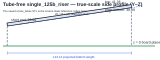
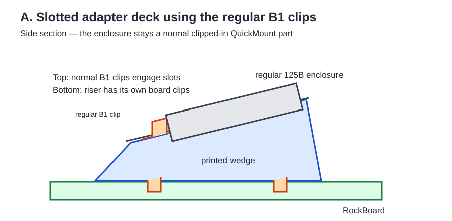
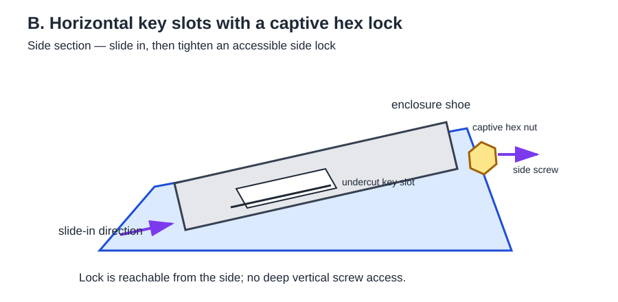
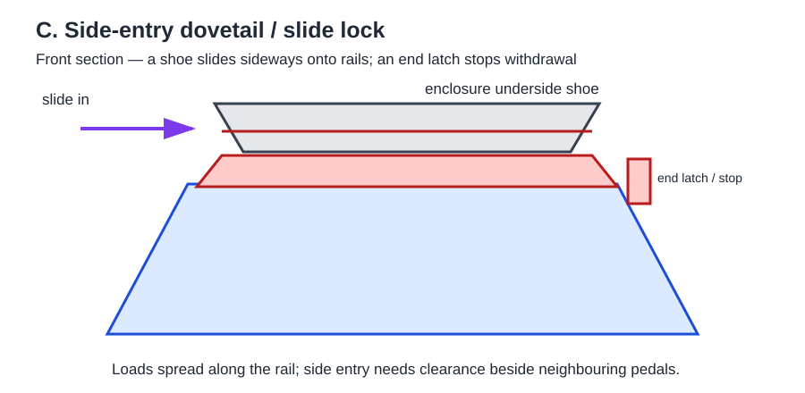
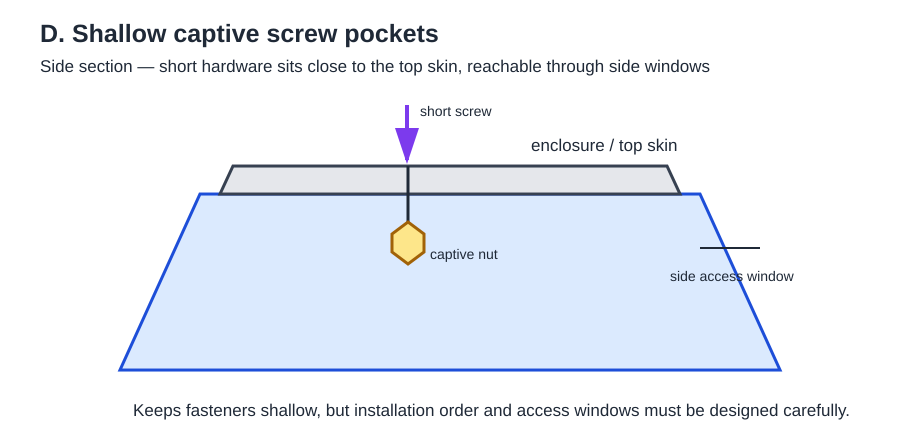

# Single-125B riser: attachment brainstorm

Status: **prototype implemented; fit validation pending**.

Prototype 1 is now modelled in `src/dual_125b_riser.py`, with
`dwg/left_125b.stl`, `dwg/right_125b.stl`, and `dwg/dual_riser.stl` as its three
watertight print bodies. A dovetail coupon and a real-board clip fit test remain
required before treating it as a production print.

Revision 2 uses three rails per plate (a broad centre rail and two lighter outer
rails), removes the raised centre ridge, and initially explored an underside
hex-lock. That lock and its centre-rail screw holes are now removed. The wedge has
four board clips in two spread pairs and shallow stadium recesses in its outside
faces; its 4 mm structural walls, deck skin, rail roots, and clip roots remain
solid-wall load paths.

Revision 3 replaces the lobed B1 outline on the two sliding plates with a smooth
72 x 125.5 tangent rounded perimeter (r 6.6). The smaller dovetails are moved
toward the two short plate edges at Y = +/-44 mm, clear of the end screw rows;
the centre dovetail remains broad and centred. All three rails run all the way to
the tangent perimeter's side edges.

All endcap experiments are removed. The current prototype has only the three
plain sliding rails; its next design step is a separate post-insertion lock.

### Post-insertion lock candidates

| Candidate | Operation | PETG assessment |
| --- | --- | --- |
| Side pressure tab | A broad PETG cantilever on the outer wedge face snaps into a shallow notch on each plate after it slides home. A finger or tool presses it to release. | Best first option if the tab is only anti-walk retention: use a broad, long flexure and a small 0.6–0.8 mm catch. |
| Centre bridge keeper | A small removable bridge slides down into the 10 mm centre gap after both plates are installed; its two lips overlap the plates' inner shoe ends. | Positive and printable, but is a loose separate part. |
| Captive hardware latch | A screw or quarter-turn cam in the wedge bears into a plate-side notch after insertion. | Most positive, but adds hardware and access constraints. |

Recommendation: prototype a **side pressure tab** first. The dovetail flanks and
uncut centre stop carry foot load; the tab only prevents the plate walking back
out along X, so PETG creep is not asked to carry the pedal force.

Prototype revision 5 implements this selection: each outer wedge wall carries a
15 x 10 x 2 mm PETG cantilever below the centre rail. Its 1.1 mm ramped catch
snaps into a 1.3 mm deep underside notch on the corresponding plate after the
plate slides inward. The tabs are anti-walk retainers only; the dovetails and the
centre stop remain the load-bearing features.




## Fixed geometry

The current reference placement is the tube-free [single_125b_riser](./src/single_125b_riser.py):

- the regular Type B1 / 125B plate is 125.5 x 72 x 3 mm;
- the plate is tipped about the side-hole end;
- its countersunk face is coplanar with the PedalRiser deck;
- the close clearance/snap hole rows ride toward the 40 mm end;
- the short end is at 20 mm and the deck span is parameterised as 20/40/135 mm;
- the final product should use a regular `single_125b_enclosure`, including its two integral QuickMount clips;
- the finished riser itself must clip into the RockBoard, without requiring unusually long screws or access through deep screw tubes.

The previous tube experiment is preserved as [screw_tubes.stl](./dwg/screw_tubes.stl). It is a reference artifact, not the active design. Tubes are deliberately absent from the current riser generator.

## Design goals and constraints

1. The pedal/enclosure should install and remove from above like a normal B1 QuickMount part.
2. The riser should install and remove from the RockBoard using the normal board-side clip vocabulary where practical.
3. No screw head should be buried at the bottom of a tall tube; any fastener used for the riser body must be accessible from the board side or from a reachable side face.
4. Keep the 20/40/135 deck placement and the close-row orientation unchanged.
5. Avoid trapping the enclosure permanently inside the riser. A printable part should have a clear insertion/removal direction and reasonable support-free geometry.
6. Preserve a path to honeycomb or sparse backfill in the wedge rather than filling the whole wedge with solid PETG.

## Alternative A — slotted adapter deck with the regular B1 clips



**Concept:** make the top of the wedge a thin, slotted adapter sheet. The regular 125B enclosure drops onto that sheet using its own two integral clips, exactly as it would on a board or StepUp top.

**How it works**

- The wedge carries a 3 mm top sheet on the 20/40 slope.
- It gets two board-style 18 mm slots positioned for the B1 clip pair, or a B1-specific pair of slots if the 95 mm clip spacing is retained.
- The enclosure is clipped in from the same direction as the normal QuickMount installation.
- The wedge's lower face gets its own RockBoard clip pair, oriented at the board plane.

**Advantages**

- Maximum reuse of the regular enclosure and the proven clip section.
- No screws between enclosure and riser.
- Easy to inspect and replace the enclosure.
- The adapter sheet can remain thin while the wedge carries the load.

**Risks / checks**

- The B1 clip spacing is 95 mm, not a whole RockBoard pitch; slot placement must be explicit and must not be confused with the board's 33.43/34 mm field.
- The enclosure clips need a stop so the enclosure cannot slide down the slope under pedal load.
- The top sheet needs an insertion clearance study around the clip mouth and the inclined front/rear edges.

**Current recommendation:** strongest first prototype. It is the least novel and gives the cleanest user experience.

## Alternative B — horizontal key slots with captive hex locks



**Concept:** replace the top QuickMount capture with two horizontal key slots in the wedge and matching pegs/heads on the enclosure or its underside. A captive hex nut or sliding hex insert locks the enclosure after it is slid into place.

**How it works**

- Slide the enclosure sideways or along the slope into two undercut key slots.
- A captive M4/M5 hex nut, thumb screw, or quarter-turn screw closes the slot at an accessible side.
- The lower wedge remains independently board-clipped.

**Advantages**

- Positive mechanical retention without a tall screw tube.
- Fasteners can be reached from the side, so screw length is controlled.
- Could tolerate a small mismatch between the regular enclosure and the wedge.

**Risks / checks**

- This changes the regular enclosure and is no longer a pure clip-in B1 installation.
- Horizontal loads and print-layer orientation at the slot throat need testing.
- Captive hardware complicates printing, insertion, and replacement.
- A stop is still needed to prevent the enclosure sliding out under vibration.

## Alternative C — shallow side-entry dovetail / slide lock



**Concept:** add a shallow dovetail or T-slot rail to the inclined top and a matching shoe on the enclosure. The enclosure slides in from the side; an end stop and a small accessible latch prevent withdrawal.

**Advantages**

- No long screws and no deep vertical access.
- Load is distributed along the enclosure length instead of concentrated at four holes.
- Good candidate for a removable top cassette if the wedge and enclosure need to be serviced separately.

**Risks / checks**

- Requires a custom underside shoe or a replacement enclosure base.
- More sensitive to print tolerances, wear, and debris than a clip.
- A side-entry installation may conflict with adjacent pedals on a real board.
- Dovetail orientation must resist the downhill component of pedal force.

## Alternative D — four shallow captive screw pockets, not tubes



**Concept:** retain screw attachment but use short, side-accessible pockets or nut traps inside the wedge. The enclosure sits on a thin top skin; fasteners are reached from the underside before the riser is clipped to the board, or from exposed side windows.

**Advantages**

- Conventional mechanical joint and easy to calculate.
- No full-height tubes; screw length can be close to the local 3 mm top skin plus nut thickness.
- Can use heat-set inserts or captive hex nuts.

**Risks / checks**

- Installation order becomes important: fasteners may need to be installed before the riser is clipped to the board.
- Still needs a sensible access path and may be less convenient than clips.
- Nut pockets create local stress concentrations and should be filleted.

## Comparison

| Option | Regular B1 enclosure unchanged | No long screws | Easy removal | Novel geometry | First prototype |
| --- | ---: | ---: | ---: | ---: | ---: |
| A. Slotted adapter deck + B1 clips | Yes | Yes | Yes | Low | **Yes** |
| B. Key slots + captive hex | No / minor shoe | Yes | Medium | Medium | Maybe |
| C. Side dovetail / slide lock | No | Yes | Medium | High | Later |
| D. Shallow captive screw pockets | Usually | Mostly | Low/medium | Medium | Fallback |

## Proposed next design pass

1. Build a regular Type B1 enclosure with both clips as the top reference body.
2. Build Alternative A as a thin inclined adapter deck on the existing 20/40/135 wedge envelope.
3. Add the riser's own RockBoard clips underneath, keeping their board-side geometry independent from the top capture.
4. Check clip spacing, insertion direction, downhill stop, printable overhangs, and removal clearance against the PedalRiser comparison layout.
5. Only if the B1 clips cannot be made to engage reliably should Alternative B be prototyped.

## Decisions needed before implementation

- Should the top adapter use the exact regular B1 clip pair at 95 mm spacing, or should the enclosure be given a new clip/slot interface?
- Should the riser clip to the RockBoard with the standard two integral clips used by the other step-up risers, or should it use a separate replaceable retainer?
- Is installation from the board's front edge acceptable, or must the riser install vertically from above?
- Is a small downhill stop/latch acceptable if it is not load-bearing?

## Confirmed twofer direction — 2026-11-15

The supplied [sketches.pptx](./brainstorms/sketches.pptx) confirms a new direction
that supersedes the single-pedal attachment options for the first prototype.

### Agreed layout

- One inclined wedge supports **two clip-free B1 top plates**.
- The taller deck end is the pedal-bottom end as installed on the RockBoard.
- Each plate slides in **from an outside end toward the centre**: the left plate
  enters from the left and the right plate enters from the right.
- Two dovetail lanes carry the plates. The light-blue solid shapes in the sketch
  are the dovetail end caps/stops.
- The plates stop at a centre ridge, leaving approximately **10 mm separation**.
  The ridge becomes a useful flat top surface once both pedals are installed.
- The wedge uses its own board-side clip-in interface. Initial planning assumes
  the proven integral clip geometry from the other step-up risers; a different
  replaceable retainer remains possible if fit testing demands it.
- Installation is from above/outer side, so a pedal already installed next to the
  ramp must not block the vertical approach to the chosen entry edge.
- The operating load is mainly vertical foot pressure, not sustained pull-out.

### Proposed first-prototype architecture

```text
left pedal plate -> | dovetail lane | centre ridge | dovetail lane | <- right pedal plate
                     outside stop       lock zone       outside stop

                      inclined PETG wedge with two board-side clip-ins
```

1. **Top plates:** use the regular B1 outline with its board-side clips removed.
   Keep its normal screw pattern and countersunk face; the dovetail shoe becomes
   the top-to-wedge interface instead of the current tube concept.
2. **Dovetail direction:** make the rails run across the pair, not down the ramp.
   This means the main foot load bears into broad, sloped rail flanks rather than
   trying to push a plate along its insertion direction.
3. **End stops:** solid PETG caps at the two exterior ends prevent over-travel.
   The centre ridge limits inward travel. Both are compression features, not
   flexible latches.
4. **Centre ridge:** target 10 mm nominal plate-to-plate gap, but leave it
   parameterised. It needs enough width for the retaining feature, a finger/tool
   relief, and a print-safe wall on each dovetail throat.
5. **Riser-to-board:** integrate the normal two board-facing clips into a lower
   base sheet. Keep their load path separate from the dovetail rails so pedal
   forces feed into the wedge walls before reaching the clips.
6. **Wedge fill:** use perimeter shells and sparse/honeycomb infill only after
   the outer walls, dovetail flanks, centre ridge, and clip roots are made thick
   enough to carry pedal pressure without relying on infill.

### PETG-specific guidance

- Dovetail flanks should be the load-bearing retention, with generous root
  fillets. Do not make a thin flexible snap tab carry the pedal load.
- Add a small insertion clearance per flank (initially 0.20–0.30 mm; calibrate
  against a short coupon) because PETG can drag and cold-flow under sustained
  contact.
- Make stops and the centre ridge solid-wall features. Avoid sharp internal
  corners at their roots.
- A pressure tab is suitable only as an anti-rattle/anti-walk keeper. It should
  not be the primary stop or the element that resists foot load.

### Centre retainer choices

| Choice | How it works | PETG assessment | Recommendation |
| --- | --- | --- | --- |
| Captive hex screw | A short horizontal screw in the centre ridge bears against a plate notch or keeper bar after both plates are slid home. | Positive and adjustable; the screw and captive nut carry retention, not PETG flex. Needs a reachable hex key. | **Preferred for prototype 1.** |
| Pressure keeper tab | A centre tongue flexes into a shallow notch after each plate reaches its stop. | Quick to use, but PETG creep and repeated flex make it less reliable as a primary lock. | Use only as a secondary anti-rattle feature. |
| Replaceable printed keeper | A small separate PETG/TPU bar drops or slides into the centre ridge after both plates are installed. | Avoids repeated flex in the main wedge and needs no metal hardware. Can be lost. | Good follow-up comparison. |

### Open measurements before modelling

1. Confirmed: the **10 mm** separation is the clear gap between the two B1 outer
   edges. The first top envelope is therefore approximately $72 + 10 + 72 = 154$
   mm wide, before rail walls or outer margins.
2. Confirmed: prototype 1 uses a captive hex screw accessed from the centre top
   ridge. Its head and tool recess must remain clear of both plate insertion
   paths, and the screw acts on a keeper/notch rather than directly on a thin
   PETG edge.
3. Choose a first dovetail rail depth and shoe thickness. A short coupon should
   establish PETG clearance before committing to the full wedge.
4. Confirm how much side clearance exists for a plate to slide inward while its
   neighbouring pedals are already in place.

