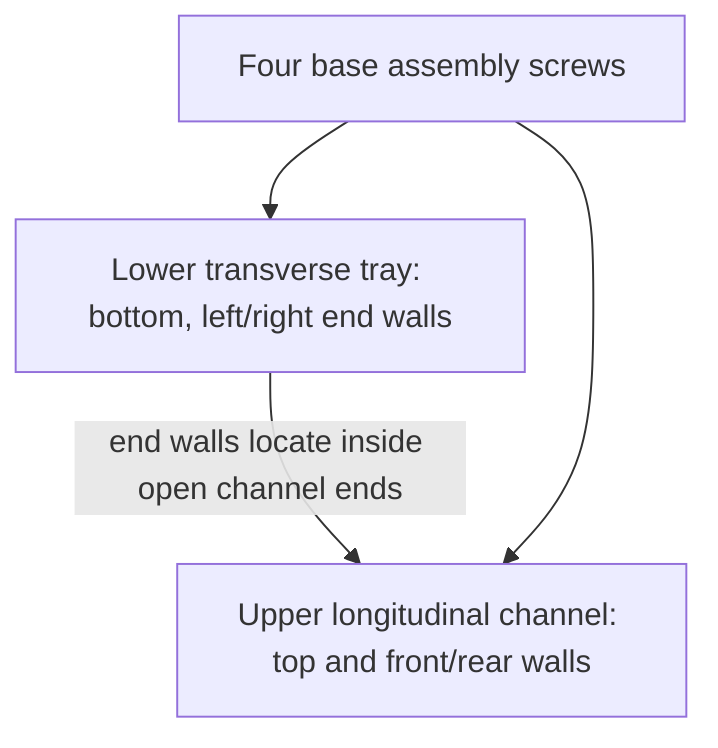

# Strymon MultiSwitch (original, pre-Plus) — mounting reference

This sheet covers the original three-foot-switch **Strymon MultiSwitch**.
It does **not** cover MultiSwitch Plus, MiniSwitch, or a generic enclosure.
It is a future QuickMount-adapter reference, not a drilling template.

## 1. Confirmed product identity

| Property | Value | Source |
| --- | --- | --- |
| Product | Original Strymon MultiSwitch (pre-Plus) | Archived Strymon page |
| Controls | Three footswitches | Archived page and reference photo |
| Connection | 1/4 in TRS via the controlled pedal's expression jack | Archived page |
| Included cable | Right-angle 1/4 in TRS | Archived page |
| Power | No separate power supply | Archived page |
| Chassis | Gunmetal-gray anodized aluminium | Archived page |
| Supported pedals | TimeLine, BigSky, and Mobius | Archived page |

The current Strymon `/product/multiswitch/` URL redirects to MultiSwitch Plus.
It must not be used as a source for this older unit. Primary source:

- <https://web.archive.org/web/20191015093548id_/https://www.strymon.net/multiswitch/>

## 2. Overall envelope

The archived original-Strymon product page does not publish mechanical
dimensions. However, zZounds lists the original MultiSwitch as **6.625 in W x
1.875 in D x 2.00 in H**. Strymon's current MultiSwitch support-page search
listing reports the same values. Convert those nominal dimensions to
$168.275 \times 47.625 \times 50.80$ mm; confirm them on the owned unit before
using them as a production fit.

| Feature | Value | Confidence | Notes |
| --- | ---: | --- | --- |
| Published overall width | 168.275 mm | Retailer specification, corroborated by Strymon support search listing | Nominal 6.625 in |
| Published overall depth | 47.625 mm | Retailer specification, corroborated by Strymon support search listing | Nominal 1.875 in |
| Published overall height | 50.80 mm | Retailer specification, corroborated by Strymon support search listing | Nominal 2.00 in |
| Observed assembled cross-width | approximately 46 mm | Owner observation | Approximately 1.625 mm below the published nominal depth; confirm datum and whether feet are included |
| Observed lower-tray cross-width | approximately 41 mm | Owner observation | Same direction; exact datum still to be recorded |

Supporting sources:

- <https://www.zzounds.com/item--STMMULTISWITCH>
- <https://www.strymon.net/support/multiswitch/>

## 3. Casing construction

The original MultiSwitch is a **mechanical two-piece assembly** made from two
perpendicular, nested bent-metal channels, not a flat box with a four-hole
base pattern:

1. The **upper longitudinal channel** forms the top and the front/rear long
   sides.
2. The **lower transverse tray** forms the bottom and bends upward at the left
   and right short ends.
3. The lower tray's upturned end walls locate inside the open end spaces of
   the upper channel; the two pieces slide together.
4. Four mechanical screws secure the lower tray to the upper channel.

The mounting-plate datum is the lower tray's external bottom-face footprint
and four base-screw centres. Internal return features are not mounting
dimensions. Any mount must clear the lower tray's upturned end walls and the
slide/removal path; it must not assume that an underside panel can be replaced
by a flat four-hole plate.

### Owner-photo observations (2026-11-15)

The photographs in [`MultiSwitch/`](./MultiSwitch/) establish the following:

- The base has **four Phillips-drive assembly screws**, one near each corner.
  They fasten the lower U-mount to the upper housing; they are not a separate
  published mounting pattern.
- No other underside mounting holes are visible.
- The lower tray's upturned end walls fit into the upper channel at the short
  ends.
- The TRS jack is on the rear face, offset from the centre toward the right
  when the rear face is viewed directly.

The photographs are not a dimensioned orthographic drawing. Do not derive a
screw pitch, thread, head diameter, countersink, or engagement depth from
pixels alone. A mount may reuse the four assembly locations only after their
thread and safe engagement depth are measured.

## 4. Measurements required before CAD

Use [`strymon_multiswitch_measurement_runbook.html`](./strymon_multiswitch_measurement_runbook.html)
to collect these readings and export them as JSON.

| Required measurement | Why it is needed |
| --- | --- |
| Lower-tray external 2D footprint and corner shape | Defines the plate-contact outline |
| Four base-screw centre spacings, edge offsets, and head clearance | Defines the fastening pattern |
| Assembly-screw positions, thread, head, and safe engagement depth | Required before reusing a base fastener for retention |
| Bottom contact areas and labels/rubber feet | Determines safe cradle/clamp locations |

## 5. Design constraints

- Treat the published envelope as a keep-out only, not a mounting-hole
  drawing; retain the observed-depth discrepancy as a fit check.
- Do not infer a thread, screw length, screw pattern, countersink, or safe
  penetration depth from MultiSwitch Plus, MiniSwitch, TimeLine, or another
  Strymon product.
- Do not block the top unit's slide/removal path.
- Use a non-invasive capture or a measured existing mechanical fastener.
- Do not drill the enclosure or model a printable mount until the U-mount and
  mechanical screws are measured.

## 6. Change record

The sheet now identifies the original MultiSwitch rather than MiniSwitch or
MultiSwitch Plus. Unsupported four-hole M3 mounting data, clearance guidance,
and executable CAD content remain removed.
